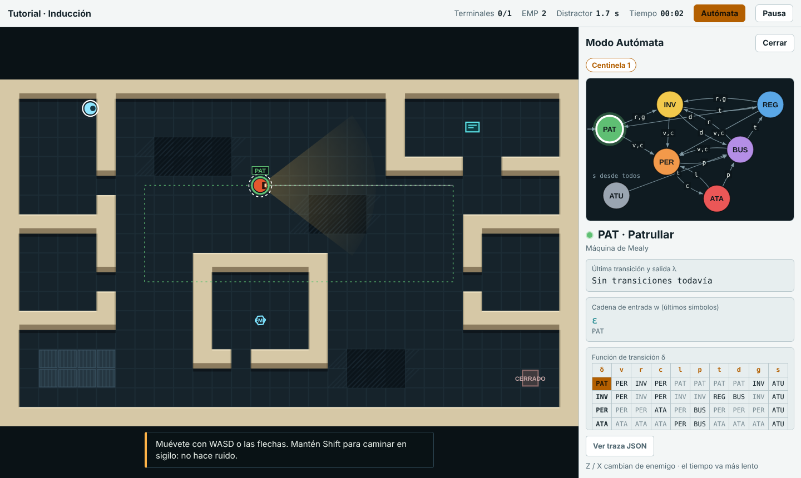
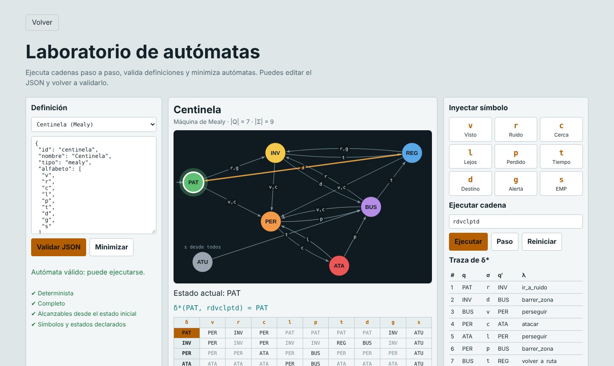

# Estado Crítico

Videojuego 2D de sigilo en el que cada enemigo es un autómata: los centinelas y el dron son **máquinas de Mealy** y la cámara de seguridad es una **máquina de Moore**. Proyecto de aula de Teoría de la Computación, Universidad de Pamplona (2026-II).



## Jugar


- **Sin conexión:** abre `dist/index.html` en el navegador.
- **GitHub Pages:** en *Settings → Pages*, elige la rama `main` y la carpeta `/docs`.

### Controles

| Acción | Computador | Celular |
| --- | --- | --- |
| Moverse | WASD o flechas | Palanca |
| Caminar en silencio | Shift | Sigilo |
| Copiar datos | E o Espacio (mantener) | Copiar |
| Pulso EMP | Q | EMP |
| Distractor | F o clic | Lanzar |
| Modo Autómata | Tab | Autómata |
| Pausa | Esc | Pausa |

## Los enemigos

| Enemigo | Tipo | Estados |
| --- | --- | --- |
| Centinela | Mealy | Patrullar, Investigar, Perseguir, Atacar, Buscar, Regresar, Aturdido |
| Cámara | Moore | Barrido, Detectando, Alarma |
| Dron | Mealy | Orbitar, Rastrear, Marcar, Recargar |

Alfabeto del Centinela: `v` visto, `c` cerca, `l` lejos, `p` perdido, `r` ruido, `g` alerta, `d` destino, `t` tiempo, `s` pulso EMP.



## Estructura

```
src/core.js      Núcleo de autómatas: δ, δ*, validador y minimizador
src/game.js      Mundo, sensores, A*, línea de visión y enemigos
src/levels.js    Tutorial y 3 niveles
src/render.js    Dibujo del mundo y de los diagramas
src/audio.js     Sonido sintetizado (Web Audio)
src/main.js      Pantallas, Modo Autómata y Laboratorio
src/index.html   Plantilla y estilos
build.py         Une todo en dist/index.html
tests/           Pruebas automatizadas, de navegador y bot de jugabilidad
docs/            Copia para GitHub Pages y capturas
```

## Construir y probar

```bash
python3 build.py                 # genera dist/index.html
node tests/run_tests.js          # 47 pruebas: núcleo, niveles, simulación, rendimiento
python3 tests/e2e.py             # pruebas de navegador (requiere Playwright)
node tests/bot.js                # bot que juega cada nivel
```

## Autor

Danny Lizka Vargas Rico · Ingeniería de Sistemas · Universidad de Pamplona

Licencia MIT.
